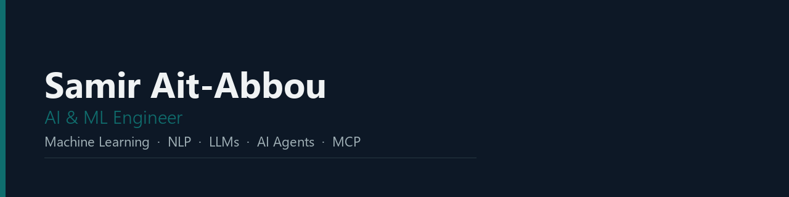

# Samir Ait-Abbou

**AI & ML Engineer** · Machine Learning · NLP · LLMs · AI Agents · MCP
 
Marseille, France · AI Consultant at MOVE2DIGITAL (European Digital Innovation Hub)

  

 

I design and ship AI systems to production, from classic machine learning to LLMs and agents, in the cloud (Azure, AWS, GCP) or fully on-premise on self-hosted GPUs. I choose the right tool for each problem (ML model, deterministic rules or LLM), and I measure what I ship.

 

| **10×** | **3–5 days → 30 min** | **1,200+** | **24 M** | **300** |
| :--: | :--: | :--: | :--: | :--: |
| faster than real time self-hosted medical transcription | compliance reports 3 specialized agents | ERP tables queried in natural language | water-quality analyses geospatial data pipeline | agent trials open MCP benchmark |

 

## Featured

 

| Project | What it does | Stack |
| :-- | :-- | :-- |
| **[code-mode-bench](https://github.com/samir-aitabbou/code-mode-bench)** | Controlled benchmark of Code Mode vs classic MCP tool calling on a single 24 GB GPU: 300 trials, automatic SQL grading, raw results and traces. [Read the write-up](https://samiraitabbou.hashnode.dev/code-mode-benchmark-24gb-gpu). | Python · vLLM · MCP · Docker |
| **[AI-Embedding-Advisor-Pro](https://github.com/samir-aitabbou/AI-Embedding-Advisor-Pro)** | Describe your NLP use case in plain language and get a justified top 3 of embedding models, cross-referenced with the MTEB benchmark. | JavaScript · Gemini API · MTEB · Docker |
| **[rag-chunk-optimizer](https://github.com/samir-aitabbou/rag-chunk-optimizer)** | Conversational RAG agent and dashboard comparing 9 chunking strategies on retrieval relevance and speed. | Python · Streamlit · FAISS · Sentence Transformers |
| **[Pull-Request-Agent-Project](https://github.com/samir-aitabbou/Pull-Request-Agent-Project)** | Webhook-driven agent that reads Hugging Face Hub discussions and opens pull requests with tag suggestions, through an MCP server. Built in the Hugging Face MCP course. | Python · FastMCP · FastAPI · Docker |

## Writing

- **[I Benchmarked Code Mode vs Classic MCP on a Single 24 GB GPU](https://samiraitabbou.hashnode.dev/code-mode-benchmark-24gb-gpu)** · 280 agent trials, two open models, six tasks
- **[MCP vs Code Mode: What Actually Changes, and When to Use Which](https://samiraitabbou.hashnode.dev/mcp-vs-code-mode)** · a guide built from the primary sources
- **[Cloud API or local infrastructure?](https://www.linkedin.com/feed/update/urn:li:activity:7434555048946388993/)** (FR) · cost study at 300 M tokens/month: ~$28,000 vs ~$3,300 in year one
- **[Choosing embedding models for RAG](https://www.linkedin.com/pulse/optimiser-le-choix-des-mod%C3%A8les-dembeddings-pour-les-rag-ait-abbou-gmhue/)** (FR) · benchmark method and selection criteria
- **[EU AI Act, Article 15](https://www.linkedin.com/feed/update/urn:li:activity:7480775219897524224/)** (FR) · accuracy, robustness and cybersecurity of high-risk AI systems

## Selected work

| Client | What I built | Result |
| :-- | :-- | :-- |
| **Rofim** · healthcare | Medical transcription pipeline migrated from AWS to fully self-hosted (Whisper, pyannote, Kyutai, vLLM) | Up to **10× faster than real time**, no third-party cloud |
| **Laneva Boats** · maritime | 3 specialized agents (Google ADK) for ES-TRIN compliance reports; RAGAS benchmark of 6 embedding models | **3–5 days → 30 min** · MRR 0.950 · Recall@5 96.7% |
| **D3E** · engineering | On-premise document platform: multimodal extraction (Docling, Qwen2.5-VL), OCR, RAG assistant | **3 models orchestrated on one GPU** |
| **D3E** · engineering | Local LLM connected to an ERP through function calling, SQL guardrails, Kubernetes inference | **1,200+ tables** queried in natural language |
| **Candide Blue** · water | Filtration recommendation pipeline, geospatial address-to-network matching (GeoPandas, PostGIS) | **24 M analyses** · 98.7% coverage |
| **Greencityzen** · IoT | Conv1D autoencoder for anomaly detection, served as a microservice (PyTorch, MLflow, FastAPI) | Retrainable model in production |
| **Now4Women** · healthcare | Multi-agent platform (LangChain, OpenAI Agents SDK), serverless on AWS with Terraform | From scoping to production |

## Stack

 

**ML & DL** PyTorch · TensorFlow · scikit-learn · computer vision · anomaly detection 
**NLP & Speech** Transformers · Hugging Face · Docling · OCR · Whisper · pyannote 
**LLMs & GenAI** vLLM · Ollama · RAG · Qdrant · FAISS · Qwen2.5-VL · fine-tuning 
**AI Agents** Google ADK · OpenAI Agents SDK · LangChain · LangGraph · MCP · guardrails 
**Evaluation & MLOps** RAGAS · Langfuse · MLflow · Docker · Kubernetes · CI/CD · Terraform 
**Data** SQL · Pandas · GeoPandas · PostgreSQL/PostGIS · Spark · Kafka · Airflow · BigQuery

## GitHub activity

## Background

**Experience** AI Consultant, MOVE2DIGITAL (2024–now) · Data Scientist intern, Alteca (2024) · Big Data Engineer intern, UM6P (2023) · Data Science internships, MediaCaris and 3D Smart Factory (2022) 
**Education** MSc Computer Science, Artificial Intelligence, Avignon Université (2024) · Engineering degree, Software and Intelligent Systems, FST Tanger (2023) 
**Certifications** Hugging Face: Supervised Fine-tuning, AI Agents Fundamentals, Fundamentals of MCP, MCP Automation in Production · InnovatiCS: Data Science and AI

 

> *"[…] une vraie maîtrise des architectures IA locales, mais surtout une capacité à les intégrer intelligemment dans un système d'information existant."*
> **Benjamin Navarrete**, Group IT Manager, D3E · client

> *"Samir was reliable, structured, and clear in his approach, and delivered exactly what we needed at that early stage."*
> **Natalia Gaydukova**, Founder & CEO, NOW For Women · client

 

Working on an ML, LLM or AI agent project? <a href="mailto:samir.1.aitabbou@gmail.com">Email me</a> or connect on <a href="https://www.linkedin.com/in/samir-ait-abbou-b5090a1bb/">LinkedIn</a>.

