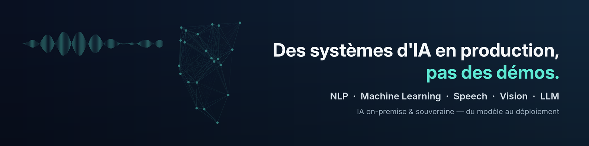

# Samir AIT-ABBOU

**Data Scientist & ML Engineer** · NLP · Machine Learning · LLM · IA agentique
 
Marseille, France · Consultant IA chez MOVE2DIGITAL (European Digital Innovation Hub)

 

 

Je conçois et mets en production des systèmes d'IA, du machine learning classique aux LLM. Ingénieur en systèmes intelligents et diplômé d'un Master IA, je choisis l'approche adaptée à chaque problème (modèle ML, règles déterministes ou LLM) et je mesure ce que je livre.

Ma spécialité : **l'IA on-premise**, avec des modèles auto-hébergés sur GPU et sans dépendance au cloud, pour des clients en santé, industrie, énergie et environnement.

 

## Domaines

| | Ce que je fais | En production chez |
| :-- | :-- | :-- |
| **Machine & Deep Learning** | Détection d'anomalies, computer vision, classification, industrialisation MLOps | Greencityzen, Sepalumic |
| **NLP & Speech** | Extraction documentaire, OCR, transcription et diarisation, classification de textes | Rofim, D3E |
| **LLM & GenAI** | LLM auto-hébergés (vLLM), RAG, modèles de vision, plusieurs modèles sur un seul GPU | D3E, Rofim |
| **IA agentique** | Systèmes multi-agents, function calling, guardrails, anti-hallucination | Laneva Boats, Now4Women |

 

## Réalisations

| Client | Mission | Résultat |
| :-- | :-- | :-- |
| **Rofim** · santé | Migration d'un pipeline de transcription médicale d'AWS vers du 100 % auto-hébergé (pyannote, Whisper, Kyutai, vLLM) | Jusqu'à **10× plus rapide que le temps réel**, sans cloud tiers |
| **Laneva Boats** · naval | 3 agents spécialisés (Google ADK) pour automatiser les rapports de conformité ES-TRIN, benchmark RAGAS de 6 modèles d'embeddings | **3–5 jours → 30 min** · MRR 0,950 · Recall@5 96,7 % |
| **D3E** · ingénierie | Plateforme documentaire on-premise : extraction multimodale (Docling, Qwen2.5-VL), OCR, assistant RAG | **3 modèles orchestrés sur un seul GPU** |
| **D3E** · ingénierie | LLM local intégré à un ERP par function calling, guardrails SQL, inférence Kubernetes | **1 200+ tables** interrogeables en langage naturel |
| **Candide Blue** · eau | Pipeline de recommandation de filtration, jointure géospatiale adresse → réseau d'eau (GeoPandas, PostGIS) | **24 M d'analyses** · 98,7 % de couverture |
| **Greencityzen** · IoT | Autoencodeur Conv1D de détection d'anomalies industrialisé en microservice (PyTorch, MLflow, FastAPI) | Modèle réentraînable en production |
| **Sepalumic** · industrie | Vision par ordinateur pour identifier des profilés aluminium sur photos terrain | Identification automatique en atelier |
| **Now4Women** · santé | Plateforme multi-agents (LangChain, OpenAI Agents SDK) déployée en serverless sur AWS avec Terraform | Du diagnostic à la production |

 

## Stack

 

| Domaine | Technologies |
| :-- | :-- |
| **Machine & Deep Learning** | PyTorch · TensorFlow · Scikit-learn · CNN · LSTM · autoencodeurs · computer vision |
| **NLP & Speech** | Transformers · BERT · Hugging Face · Docling · OCR · Whisper · Kyutai · pyannote |
| **LLM & GenAI** | vLLM · Ollama · RAG · Qdrant · FAISS · Qwen2.5-VL · fine-tuning |
| **IA agentique** | Google ADK · OpenAI Agents SDK · LangChain · LangGraph · MCP · n8n · guardrails |
| **Évaluation** | RAGAS · Langfuse · MLflow · benchmarks (MRR, Recall@k) |
| **Data** | Python · SQL · Pandas · GeoPandas · PostgreSQL/PostGIS · Spark · Kafka · Airflow · BigQuery |
| **MLOps & Cloud** | Docker · Kubernetes · FastAPI · CI/CD · Terraform · AWS · GCP |

 

## Écrits

- **[API cloud ou infrastructure locale ?](https://www.linkedin.com/feed/update/urn:li:activity:7434555048946388993/)** Étude de coûts sur 300 M de tokens par mois : environ 28 000 $ contre 3 300 $ la première année
- **[Optimiser le choix des modèles d'embeddings pour un RAG](https://www.linkedin.com/pulse/optimiser-le-choix-des-mod%C3%A8les-dembeddings-pour-les-rag-ait-abbou-gmhue/)** Méthode de benchmark et critères de sélection
- **[AI Act, article 15](https://www.linkedin.com/feed/update/urn:li:activity:7480775219897524224/)** Exactitude, robustesse et cybersécurité des systèmes d'IA à haut risque
- **[Quelle méthode d'inférence choisir ?](https://www.linkedin.com/feed/update/urn:li:activity:7345611312535617536/)** API managée, endpoints dédiés, local ou navigateur
- **[IA durable](https://www.linkedin.com/feed/update/urn:li:activity:7311033151022075904/)** Distillation, quantization, LoRA et mesure de l'empreinte carbone

 

## Parcours

| | |
| :-- | :-- |
| **2024 → aujourd'hui** | Consultant Data Scientist & ML Engineer · MOVE2DIGITAL |
| **2024** | Data Scientist (stage de fin d'études) · Alteca |
| **2023** | Big Data Engineer (stage) · UM6P |
| **2022** | Data Scientist (stages) · MediaCaris, 3D Smart Factory (NLP) |
| **2023 – 2024** | Master Informatique, Intelligence Artificielle · Avignon Université |
| **2020 – 2023** | Diplôme d'ingénieur, Logiciels et Systèmes Intelligents · FST Tanger |

**Certifications** · Hugging Face : Supervised Fine-tuning, AI Agents Fundamentals, Fundamentals of MCP, MCP Automation in Production · InnovatiCS : Data Science and AI

 

> *« […] une vraie maîtrise des architectures IA locales, mais surtout une capacité à les intégrer intelligemment dans un système d'information existant. »*
> **Benjamin Navarrete**, Responsable informatique groupe, D3D · client

> *« Samir was reliable, structured, and clear in his approach, and delivered exactly what we needed at that early stage. »*
> **Natalia Gaydukova**, Founder & CEO, NOW For Women · client

 

Un projet de NLP, de ML ou d'IA on-premise ? <a href="mailto:samir.1.aitabbou@gmail.com">Écrivez-moi</a> ou retrouvez-moi sur <a href="https://www.linkedin.com/in/samir-ait-abbou-b5090a1bb/">LinkedIn</a>.

